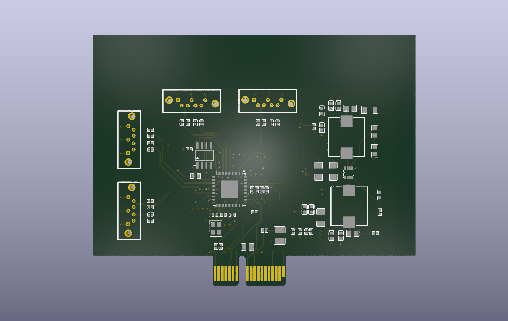

# 4-Layer PCIe-to-SATA Adapter (Marvell 88SE9215).


*3D rendering top side (KiCad Raytracing)*

---

## 1. Project Overview
A compact 4-layer PCIe Gen2 x1 to 4-Port SATA 6 Gbps expansion card designed around the **Marvell 88SE9215** controller. 
This project serves as a first step into a homemade NAS server (to simply store data like pictures or videos). 
The goal was to make it from old hardware like a laptop, this card would help to add storage from HDD or SDD from the PCIe port.
I designed everything so it can be made with **JLCPCB SMT Assembly** but the price is too expensive for now to take it into manufacturing.

---

## 2. Key Specifications & System Architecture

| Feature | Specification |
| :--- | :--- |
| **Host Interface** | PCIe Gen2 x1 (5.0 Gbps per lane, Gold Finger PCB Edge Connector) |
| **SATA Controller** | Marvell 88SE9215 (76-pin QFN) |
| **SATA Ports** | 4x Standard 7-pin SATA 6 Gbps connectors |
| **Clocking** | 25.000 MHz Passive Crystal Resonator (SMD 3225 4-Pin, $C_L = 12\text{ pF}$) |
| **Power Supply** | PCIe +3.3V bus power to dual step-down buck regulators ($1.8\text{ V}$ & $1.0\text{ V}$) |
| **PCB Form Factor** | 4-Layer Stack-up, ENIG finish, Chamfered PCIe Edge |

### Block Diagram
```text
  ┌─────────────────┐       ┌───────────────────────┐       ┌──────────────┐
  │  PCIe Gen2 x1   │ ────> │   Marvell 88SE9215    │ ────> │  4x SATA III │
  │ Edge Connector  │       │       (QFN-76)        │       │  Connectors  │
  └─────────────────┘       └───────────────────────┘       └──────────────┘
           │                            ▲
           │                            │ 25 MHz
         +3.3V                  ┌───────────────┐
           ▼                    │ 25MHz Crystal │
   ┌───────────────┐            └───────────────┘
   │ DC-DC Bucks   │
   │ 1.8V & 1.0V   │
   └───────────────┘
```

## 3. Hardware Design & Signal Integrity

### Stack-up 

Designed for a 4-layer PCB stack-up :
- Layer 1 : High-speed differential pairs (PCIe & SATA) + buck regulator's components.
- Layer 2 : Ground plane.
- Layer 3 : Power planes (+3V3 / +1V8 / +1V0).
- Layer 4 : Decoupling capacitors, simple routing. 

### Power Distribution Network

- Dual Buck converter (MP2122) supplying power for core (+1V0) and I/O (+1V8).  
A switching regulator has been used and not an LDO because, to transform a +3V3 into a +1V0, and LDO would dissipate all additionnal voltage into heat, which could be dangerous.
- Low ESR ceramic decoupling capacitors placed on bottom layer to minimize loop inductance. 
To calculate inductances and resistances around the Buck converter, I followed the MP2122 datasheet.  

### Differential pair

To calculate width of the traces inside a differential pair, I used Saturn PCB Toolkit.  
Based on FR4 TG135 caracteristics (JLCPCB basic) and aiming for a 100 Ohms impedance for both SATA and PCIe differential pairs,  
I found a spacing between traces of 0,13mm and a width of 0,09mm.  
There are 3 differential pairs on PCIe : PRX, PTX and CLK.
For the first two, as the pins on the chip were inverted compared to the PCIe port, I switched them.  
The PCIe 2.0 specifications indicate a lane polarity that permits this kind of switch.  

## 4. Design for Manufacturing

- Fiducials placed on edge rails to ensure optical alignment as well as pick & place (SMT components).
- PCIe Edge connector designed with ENIG surface finish for high insertion durability.
- Components matched to JLCPCB SMT library.

## 5. Repository Structure

.  
├── docs/  
│  ├── schematic.pdf  
│  ├── pcb_layout.pdf  
│  └── images/  
├── hardware/  
└── manufacturing/  
   ├── gerbers/   
   ├── bom/  
   └── cpl/  

## 6. Verification & DRC status

- Schematic : ERC clean (0 errors)
- PCB Layout : DRC clean (0 errors)

## 7. Future improvements

The first step would be to manufacture this pcb and test it's accuracy.  
For a second version, it would be interesting to add power to SATA connectors as this version only deals with data and an additionnal power input is needed for all hard drivers.  
It would be wise to also rethink the architecture around the connectors so that they can be pluged directly to the board without an additionnal cable.

## 8. Licence

Distributed under the MIT License. See LICENSE for more information.
